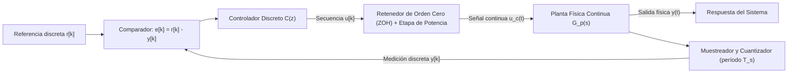
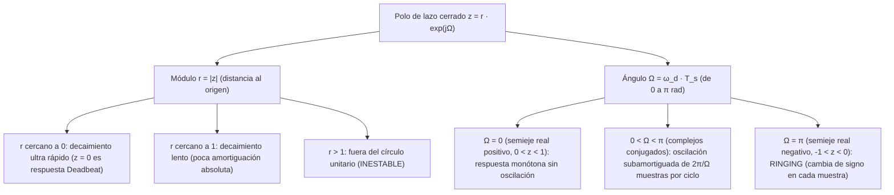
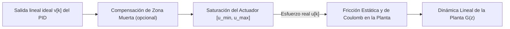
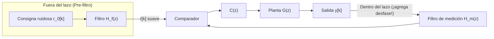

# Manual de Teoría de Control en Variable Discreta

> **Propósito de este documento:** Explicar de forma rigurosa, intuitiva y **exclusivamente desde la Teoría de Control** (sin entrar en programación ni detalles de software) todos los fenómenos matemáticos y físicos que gobiernan un lazo de control digital real —tomando como caso de estudio concreto el control de velocidad y posición de un motor de corriente continua con sensor incremental y actuación modulada—.

---

## Índice

1. [Del Mundo Continuo al Control de Datos Muestreados](#1-del-mundo-continuo-al-control-de-datos-muestreados)
2. [Muestreo, Retenedor de Orden Cero (ZOH) y Elección de $T_s$](#2-muestreo-retenedor-de-orden-cero-zoh-y-elección-de-t_s)
3. [La Transformada $\mathcal{Z}$ y la Geometría de la Estabilidad en el Plano $z$](#3-la-transformada-mathcalz-y-la-geometría-de-la-estabilidad-en-el-plano-z)
4. [Modelado y Discretización de la Planta: Velocidad vs. Posición](#4-modelado-y-discretización-de-la-planta-velocidad-vs-posición)
5. [Métodos de Discretización y el Controlador PID Discreto](#5-métodos-de-discretización-y-el-controlador-pid-discreto)
6. [Cuantización en Amplitud: Límites Físicos del Sensor y del Actuador](#6-cuantización-en-amplitud-límites-físicos-del-sensor-y-del-actuador)
7. [No Linealidades Reales en el Lazo Cerrado y su Compensación Teórica](#7-no-linealidades-reales-en-el-lazo-cerrado-y-su-compensación-teórica)
8. [Filtrado Digital de Señales: Dentro vs. Fuera del Lazo](#8-filtrado-digital-de-señales-dentro-vs-fuera-del-lazo)
9. [Análisis Transitorio, Sintonización Racional y Diagnóstico de Patologías](#9-análisis-transitorio-sintonización-racional-y-diagnóstico-de-patologías)
10. [Formulario de Referencia Rápida](#10-formulario-de-referencia-rápida)

---

## 1. Del Mundo Continuo al Control de Datos Muestreados

En la teoría de control clásica de tiempo continuo, todas las señales del lazo —la referencia $r(t)$, el error $e(t)$, la acción de control $u(t)$ y la variable controlada $y(t)$— existen en todo instante real $t \in \mathbb{R}_{\ge 0}$ y se relacionan mediante **ecuaciones diferenciales ordinarias** o funciones de transferencia en el dominio de Laplace $s$.

Sin embargo, en casi todo sistema moderno de control automático la planta física sigue siendo continua, pero la ley de control se evalúa únicamente en **instantes discretos equiespaciados** $t_k = k T_s$ (con $k = 0, 1, 2, \dots$), donde $T_s$ es el **período de muestreo** y $f_s = 1 / T_s$ es la **frecuencia de muestreo**. A esta arquitectura híbrida se la denomina **sistema de control de datos muestreados** (*sampled-data control system*).

Para estudiar este lazo sin confusiones conceptuales conviene distinguir **tres tipos de señales**:

| Tipo de señal | Tiempo | Amplitud | Ejemplo físico en un banco de control |
|---|---|---|---|
| **Continua** $y(t)$ | Continuo ($t \in \mathbb{R}$) | Continua ($\in \mathbb{R}$) | Posición angular o velocidad real del eje mecánico |
| **En tiempo discreto** $y[k]$ | Discreto ($k \in \mathbb{Z}$) | Continua ($\in \mathbb{R}$) | Abstracción matemática ideal usada en la Transformada $\mathcal{Z}$ |
| **Digital (cuantizada)** $y_q[k]$ | Discreto ($k \in \mathbb{Z}$) | Discreta (escalones finitos) | Cuentas enteras de un encoder óptico o niveles discretos de actuación |

La teoría lineal en variable discreta parte del segundo caso (tiempo discreto y amplitud continua) para analizar estabilidad y respuesta dinámica mediante la Transformada $\mathcal{Z}$, y luego incorpora los efectos del tercer caso (cuantización y no linealidades) como perturbaciones acotadas o elementos no lineales del lazo.

---

## 2. Muestreo, Retenedor de Orden Cero (ZOH) y Elección de $T_s$

En control continuo las únicas elecciones del diseñador son la estructura del controlador y sus ganancias. En control discreto aparece un parámetro estructural previo que condiciona todo lo demás: **el período de muestreo $T_s$**.

### 2.1 El Retenedor de Orden Cero (*Zero-Order Hold*, ZOH) y la pérdida de fase

El controlador discreto entrega un número $u[k]$ cada $T_s$ segundos, pero la planta física necesita una excitación definida durante todo el tiempo continuo $t$. El mecanismo estándar consiste en **mantener constante** el último valor calculado hasta que llegue la muestra siguiente:

$$
u_c(t) = u[k], \qquad k T_s \le t < (k + 1) T_s
$$

Esto convierte la secuencia de números $u[k]$ en una onda continua escalonada. En el dominio de Laplace, el bloque Retenedor de Orden Cero posee la función de transferencia:

$$
G_{\text{ZOH}}(s) = \frac{1 - e^{-s T_s}}{s}
$$

Si evaluamos su respuesta en frecuencia sustituyendo $s = j\omega$:

$$
G_{\text{ZOH}}(j\omega) = T_s \, \frac{\sin(\omega T_s / 2)}{\omega T_s / 2} \, e^{-j \omega T_s / 2}
$$

Observando el factor exponencial complejo $e^{-j \omega T_s / 2}$ aparece una conclusión fundamental de la teoría de control digital:

> **Efecto dinámico del ZOH:** Mantener constante la acción de control entre muestras equivale, en fase, a introducir un **retardo puro de tiempo igual a medio período de muestreo** ($\tau_{\text{eq}} = T_s / 2$).

Ese retardo efectivo resta fase al lazo abierto en una magnitud:

$$
\Delta \phi_{\text{ZOH}}(\omega) = -\frac{\omega T_s}{2}\text{ rad} = -\left(180^\circ \cdot \frac{f}{f_s}\right)
$$

Como el **margen de fase** mide cuán lejos está el lazo cerrado de la inestabilidad oscilatoria, un $T_s$ demasiado grande erosiona directamente el margen de fase y puede desestabilizar un controlador que en tiempo continuo era perfectamente estable.

### 2.2 Separación de escalas temporales: PWM vs. Muestreo $T_s$ vs. Planta

En sistemas electromecánicos suelen coexistir dos frecuencias periódicas muy distintas que no deben confundirse:

1. **Frecuencia de modulación de potencia ($f_{\text{PWM}}$, p. ej. $20\text{ kHz} \implies T_{\text{PWM}} = 50\ \mu\text{s}$):** Es la portadora rápida que conmuta la tensión de alimentación para sintetizar un valor medio proporcional al ciclo de trabajo (*duty cycle*). Si $f_{\text{PWM}}$ es órdenes de magnitud superior al ancho de banda eléctrico y mecánico del motor, la propia inductancia e inercia filtran la conmutación y la planta responde únicamente al **promedio** en cada intervalo.
2. **Frecuencia de muestreo del control ($f_s = 1/T_s$, p. ej. $100\text{ Hz} \implies T_s = 10\text{ ms}$):** Es el ritmo al que se mide la salida y se recalcula $u[k]$. En cada ventana $T_s = 10\text{ ms}$ caben exactamente $200$ ciclos completos de la portadora de $20\text{ kHz}$, lo que justifica modelar el conjunto actuador + PWM simplemente como un ZOH ideal de período $T_s$.

### 2.3 ¿Por qué el Teorema de Nyquist NO alcanza en lazo cerrado?

El teorema de muestreo de Nyquist-Shannon establece que para reconstruir sin *aliasing* una señal de frecuencia máxima $f_{\max}$ debe cumplirse $f_s > 2 f_{\max}$. Sin embargo, a $f = f_s / 2$ (la **frecuencia de Nyquist**), la fórmula anterior muestra que el ZOH introduce un desfase de **$-90^\circ$**, lo cual resulta catastrófico para cualquier lazo realimentado.

En diseño de sistemas de control digital se emplean reglas mucho más estrictas basadas en la dinámica deseada de lazo cerrado:

- **Por ancho de banda de lazo cerrado ($f_{bw}$):**
  $$
  10 \, f_{bw} \le f_s \le 30 \, f_{bw}
  $$
- **Por constante de tiempo dominante de la planta ($\tau_m$) o tiempo de subida ($t_r$):**
  $$
  T_s \le \frac{\tau_m}{10} \qquad \text{o bien} \qquad 4 \le \frac{t_r}{T_s} \le 10\text{ muestras en el flanco de subida}
  $$

Por ejemplo, para un motor DC pequeño cuya constante de tiempo mecánica típica es $\tau_m \approx 80\text{–}200\text{ ms}$, elegir $T_s = 10\text{ ms}$ ($f_s = 100\text{ Hz}$) proporciona entre $8$ y $20$ muestras por constante de tiempo: el desfase añadido por el ZOH en el cruce de ganancia es de apenas unos pocos grados.

### 2.4 La paradoja de muestrear "demasiado rápido" ($T_s \to 0$)

Un error conceptual frecuente es suponer que disminuir $T_s$ indefinidamente siempre mejora el control. En variable discreta real ocurre una degradación severa cuando $T_s$ es excesivamente pequeño:

1. **Amplificación del ruido de cuantización al derivar:** La velocidad estimada y la acción derivativa dividen diferencias entre muestras consecutivas ($\Delta y[k]$) por $T_s$. Si $T_s$ es tan corto que entre dos muestras el sensor apenas avanza $0$ o $1$ escalón de cuantización, dividir por un $T_s$ diminuto convierte la señal en trenes de impulsos ruidosos enormes.
2. **Degeneración numérica de polos en $z = +1$:** Dado que los polos discretos se ubican en $z_i = e^{p_i T_s}$, cuando $T_s \to 0$ todos los polos y ceros del sistema se apiñan infinitesimalmente cerca del punto $(1, 0)$ del plano $z$. Pequeños errores de redondeo en los coeficientes alteran drásticamente la ubicación efectiva de las raíces.

### 2.5 Invarianza temporal e impacto del *Jitter*

Toda la teoría clásica en $\mathcal{Z}$ presupone que el sistema es **invariante a los desplazamientos** (*LTI discreto*), es decir, que $t_k - t_{k-1} = T_s$ es **rigurosamente constante**. Cuando el instante real de muestreo fluctúa ($T_k = T_s + \delta_k$, fenómeno conocido como ***jitter* de muestreo**):

- La integral numérica pondera muestras con intervalos falsos.
- La derivada numérica divide un cambio físico real ocurrido durante $T_s + \delta_k$ por un $T_s$ nominal fijo, inyectando ruido paramétrico proporcional a $\delta_k / T_s$.

Por ello, en teoría de control digital el determinismo temporal del período $T_s$ es una condición matemática de validez del modelo, no un mero detalle operativo.

---

## 3. La Transformada $\mathcal{Z}$ y la Geometría de la Estabilidad en el Plano $z$

### 3.1 Ecuaciones en diferencias y el operador retardo $z^{-1}$

Mientras que un controlador continuo opera con derivadas e integrales respecto al tiempo, un controlador discreto sólo puede combinar algebraicamente muestras presentes y pasadas mediante una **ecuación en diferencias lineal de coeficientes constantes**:

$$
u[k] + a_1 u[k-1] + \dots + a_n u[k-n] = b_0 e[k] + b_1 e[k-1] + \dots + b_m e[k-m]
$$

La **Transformada $\mathcal{Z}$** define para una secuencia causal $x[k]$ ($k \ge 0$):

$$
X(z) = \mathcal{Z}\{x[k]\} = \sum_{k=0}^{\infty} x[k] \, z^{-k}
$$

Su propiedad más poderosa es la **propiedad de desplazamiento temporal** (con condiciones iniciales nulas):

$$
\mathcal{Z}\{x[k - 1]\} = z^{-1} X(z)
$$

Así como en Laplace multiplicar por $1/s$ significa *integrar*, en el dominio $\mathcal{Z}$ multiplicar por $z^{-1}$ significa simplemente **recordar el valor de hace un período de muestreo**. Esto transforma cualquier ecuación en diferencias en una fracción racional algebraica llamada **Función de Transferencia Pulso** $G(z) = Y(z)/U(z)$.

### 3.2 El mapeo $z = e^{s T_s}$ y el Círculo Unitario

Si tomamos un modo exponencial continuo $x(t) = e^{s t}$ con $s = \sigma + j\omega$ y lo muestreamos en $t = k T_s$, obtenemos $x[k] = (e^{s T_s})^k = z^k$. De aquí surge la transformación fundamental entre el plano $s$ y el plano $z$:

$$
z = e^{s T_s} = e^{(\sigma + j\omega) T_s} = \underbrace{e^{\sigma T_s}}_{r = |z|} \, e^{j \underbrace{\omega T_s}_{\Omega = \angle z}}
$$

Examinemos qué ocurre con las tres regiones del plano $s$:

| Región en el plano continuo $s$ | Condición sobre $\sigma = \operatorname{Re}(s)$ | Módulo $r = \|z\| = e^{\sigma T_s}$ | Región en el plano discreto $z$ | Comportamiento temporal $r^k$ |
|---|---|---|---|---|
| **Semiplano izquierdo (SPI)** | $\sigma < 0$ | $\|z\| < 1$ | **Interior del círculo unitario** | Convergente ($r^k \to 0$): **Estable** |
| **Eje imaginario ($j\omega$)** | $\sigma = 0$ | $\|z\| = 1$ | **Circunferencia unitaria** | Marginal (constante u oscilación sostenida) |
| **Semiplano derecho (SPD)** | $\sigma > 0$ | $\|z\| > 1$ | **Exterior del círculo unitario** | Divergente ($r^k \to \infty$): **Inestable** |

> **Diferencia crítica con control continuo:** En tiempo continuo, un sistema de primer orden con retroalimentación proporcional positiva $K_p > 0$ jamás se vuelve inestable (su polo $s = -(1 + K_p K_m)/\tau_m$ sólo se desplaza más hacia $-\infty$ al subir $K_p$). **En tiempo discreto sí puede volverse inestable**: al aumentar $K_p$, el polo de lazo cerrado cruza el origen hacia el semieje real negativo y termina saliendo del círculo unitario por **$z = -1$**, destruyendo la estabilidad debido al retardo implícito del muestreo y retención.

### 3.3 Cómo "leer" la posición de los polos dentro del círculo unitario

La ubicación geométrica de los polos de lazo cerrado $z_p = r e^{\pm j\Omega}$ dentro del círculo unitario dicta por completo la forma de la respuesta transitoria:

Merece especial atención el **semieje real negativo ($-1 < z < 0$)**:
Si el lazo cerrado tiene un polo real negativo $z_p = -0{,}8$, su evolución natural es $(-0{,}8)^k = (-1)^k (0{,}8)^k$, es decir: $+1, \; -0{,}8, \; +0{,}64, \; -0{,}512, \dots$ La acción de control invierte su signo **en cada muestra individual** (a la mitad de la frecuencia de muestreo, $f_s / 2$). Este fenómeno se llama ***ringing*** (campaneo inter-muestral), no tiene equivalente en sistemas continuos reales de primer orden, somete al actuador a esfuerzos térmicos y mecánicos severos y debe evitarse manteniendo los polos dominantes en el semiplano derecho del círculo unitario ($\operatorname{Re}(z) > 0$).

---

## 4. Modelado y Discretización de la Planta: Velocidad vs. Posición

Un mismo motor físico da lugar a **dos problemas de control radicalmente distintos** según se realimente su velocidad angular $\omega$ o su posición angular $\theta$. Comprender esta diferencia explica por qué requieren ganancias y estrategias diferentes.

Para obtener el modelo discreto exacto que "ve" el controlador digital al actuar a través de un ZOH sobre una planta continua $G(s)$, se utiliza la **transformación invariante al escalón**:

$$
G(z) = (1 - z^{-1}) \, \mathcal{Z}\!\left\{ \frac{G(s)}{s} \right\} = \frac{z - 1}{z} \, \mathcal{Z}\!\left\{ \left. \mathcal{L}^{-1}\!\left(\frac{G(s)}{s}\right) \right|_{t = k T_s} \right\}
$$

### 4.1 Planta de Velocidad: Sistema Tipo 0

Cuando la constante de tiempo eléctrica de armadura ($\tau_e = L_a / R_a$) es despreciable frente a la constante de tiempo mecánica ($\tau_m$), la relación entre el mando de entrada $u(t)$ y la velocidad angular $\omega(t)$ es de **primer orden**:

$$
G_v(s) = \frac{\Omega(s)}{U(s)} = \frac{K_m}{\tau_m s + 1}
$$

donde $K_m$ es la ganancia estacionaria del motor (velocidad alcanzada por unidad de mando) y $\tau_m$ es el tiempo que tarda en alcanzar el $63{,}2\%$ de su velocidad final ante un escalón en lazo abierto.

Aplicando la discretización exacta con ZOH se obtiene:

$$
G_v(z) = \frac{\Omega(z)}{U(z)} = \frac{K_m (1 - a)}{z - a}, \qquad \text{donde } a = e^{-T_s / \tau_m} \in (0, 1)
$$

**Consecuencias clave para Teoría de Control:**
1. **Un único polo estable en $z = a$:** Por ejemplo, si $\tau_m = 100\text{ ms}$ y $T_s = 10\text{ ms}$, entonces $a = e^{-0{,}1} \approx 0{,}905$.
2. **Ausencia de integrador natural (Sistema Tipo 0):** Como $G_v(z)$ no posee ningún polo en $z = 1$, su ganancia estática es finita: $\lim_{z \to 1} G_v(z) = K_m$.
3. **Necesidad obligatoria de acción Integral ($K_i$):** Si se cierra el lazo únicamente con un controlador proporcional $C(z) = K_p$, aplicando el **Teorema del Valor Final discreto** ante una referencia escalón de amplitud $R_0$ ($R(z) = \frac{R_0 z}{z - 1}$):
   $$
   e_{ss} = \lim_{k \to \infty} e[k] = \lim_{z \to 1} (1 - z^{-1}) \frac{1}{1 + K_p G_v(z)} R(z) = \frac{R_0}{1 + K_p K_m} \neq 0
   $$
   Además, cualquier par de fricción constante deja una caída permanente de velocidad. Sólo al incluir un **integrador discreto** (polo en $z = 1$ dentro del controlador) el sistema pasa a **Tipo 1** y garantiza $e_{ss} = 0$.

### 4.2 Planta de Posición: Sistema Tipo 1 (Integrador Físico)

La posición angular es la integral temporal exacta de la velocidad: $\theta(t) = \int_0^t \omega(\tau)\,d\tau$, lo que en Laplace multiplica a $G_v(s)$ por $\frac{1}{s}$:

$$
G_p(s) = \frac{\Theta(s)}{U(s)} = \frac{K_m}{s(\tau_m s + 1)}
$$

Al discretizar exactamente $G_p(s)$ junto con el ZOH resulta una función de transferencia de **segundo orden**:

$$
G_p(z) = \frac{\Theta(z)}{U(z)} = K_m \, \frac{b_1 z + b_0}{(z - 1)(z - a)}
$$

con parámetros exactos:

$$
a = e^{-T_s / \tau_m}, \qquad b_1 = T_s - \tau_m (1 - a) > 0, \qquad b_0 = \tau_m (1 - a) - a T_s > 0
$$

**Tres revelaciones fundamentales sobre el control de posición discreto:**

1. **La planta ya contiene un integrador puro (polo en $z = 1$):** El eje mecánico conserva su ángulo cuando la entrada se vuelve cero. Por lo tanto, la planta de posición es intrínsecamente **Tipo 1**. En un sistema ideal sin fricción seca, un controlador **PD** (sin término integral) ya logra error estacionario nulo ante consignas constantes de posición.
2. **Aparición de un "Cero de Muestreo" ($z_0 = -b_0 / b_1$):** Obsérvese que $G_p(s)$ en continuo **no tenía ningún cero**, pero $G_p(z)$ sí tiene un cero en $z_0 = -b_0/b_1$. Cuando $T_s \ll \tau_m$ (expandiendo por Taylor), $b_1 \approx b_0 \approx \frac{T_s^2}{2\tau_m}$, por lo que **aparece un cero intrínseco muy cerca de $z = -1$**. En el Lugar de las Raíces discreto, una rama de polos es atraída hacia ese cero cercano a $-1$, reduciendo drásticamente el margen de ganancia frente al caso continuo.
3. **El peligro del doble integrador al usar $K_i > 0$:** En motores reales se suele añadir $K_i$ en posición para vencer la fricción estática residual cerca de la consigna. Pero combinar el polo en $z = 1$ de la planta con el polo en $z = 1$ del integrador del PID crea un **doble integrador en lazo abierto** $\frac{1}{(z - 1)^2}$ (Tipo 2). Dos integradores aportan $-180^\circ$ de fase desde frecuencia cero: sin suficiente acción derivativa ($K_d$, que aporta adelanto de fase mediante un cero) el sistema oscilará violentamente alrededor de la posición deseada.

### 4.3 Seguimiento de Rampa Escalonada (Modo Paso a Paso / Segundero)

Cuando la referencia no permanece fija sino que avanza periódicamente un incremento discreto $\Delta \theta$ cada intervalo $T_{\text{paso}} \gg T_s$ (por ejemplo, avanzar $6^\circ$ cada $1\text{ s}$ mientras el lazo muestrea cada $10\text{ ms}$, es decir $100$ muestras de control por cada escalón de referencia), el problema equivale a una sucesión de transitorios de posición de pequeña amplitud.

Para que cada paso sea limpio y no acumule retraso de fase respecto al reloj maestro deben cumplirse dos condiciones de diseño:
- **Tiempo de establecimiento:** $t_s \ll T_{\text{paso}}$ (p. ej., establecerse en $150\text{–}300\text{ ms}$ dentro de la ventana de $1000\text{ ms}$).
- **Respuesta cuasi críticamente amortiguada ($\zeta \approx 0{,}8\text{–}1{,}0$):** Ganancias más firmes que en posicionamiento general para vencer de inmediato la fricción estática en desplazamientos angulares cortos ($6^\circ$), pero con suficiente amortiguamiento derivativo y limpieza de memoria integral al arribar al destino para evitar que la aguja rebote hacia atrás.

### 4.4 Comparativa conceptual: Velocidad vs. Posición

| Característica de Teoría de Control | Lazo de Velocidad $\Omega(z)/U(z)$ | Lazo de Posición $\Theta(z)/U(z)$ |
|---|---|---|
| **Orden de la planta discreta** | 1.º orden | 2.º orden |
| **Polos de lazo abierto** | $z = a \in (0, 1)$ | $z_1 = 1$ (integrador) y $z_2 = a \in (0, 1)$ |
| **Tipo de sistema (planta sola)** | **Tipo 0** | **Tipo 1** |
| **Error ante escalón con control P puro** | Finito no nulo: $R_0 / (1 + K_p K_m)$ | Cero en ausencia de fricción seca |
| **Rol principal de $K_i$** | **Indispensable** para anular $e_{ss}$ y rechazar carga | Opcional/auxiliar para vencer fricción residual (riesgo de sobrepico) |
| **Rol principal de $K_d$** | Secundario (suele ser muy bajo por ruido en $\hat{\omega}[k]$) | **Esencial** para amortiguar el doble polo y frenar antes de llegar al ángulo |
| **Dominio de la acción de control $u[k]$** | Típicamente unidireccional $[0, u_{\max}]$ | Bidireccional $[-u_{\max}, +u_{\max}]$ (requiere invertir par si hay sobrepico) |

---

## 5. Métodos de Discretización y el Controlador PID Discreto

### 5.1 Del PID continuo a sus aproximaciones discretas

En tiempo continuo, la ley de control Proporcional-Integral-Derivativa paralela es:

$$
u(t) = K_p \, e(t) + K_i \int_0^t e(\tau)\,d\tau + K_d \frac{de(t)}{dt} \quad \Longleftrightarrow \quad C(s) = K_p + \frac{K_i}{s} + K_d s
$$

Para trasladar operadores continuos ($1/s$ e $s$) al plano $z$ existen tres aproximaciones numéricas clásicas de la integral/derivada:

| Método | Sustitución $s \leftarrow f(z)$ | Regla geométrica de integración | Conservación de estabilidad ($\operatorname{Re}(s)<0 \implies \|z\|<1$) | Observación práctica en PID |
|---|---|---|---|---|
| **Euler hacia adelante** (*Forward*) | $s \approx \frac{z - 1}{T_s}$ | Rectángulo con altura en $k-1$ | **No garantizada** (puede enviar polos estables fuera de $\|z\|=1$) | Poco usado en la rama derivativa pura |
| **Euler hacia atrás** (*Backward*) | $s \approx \frac{z - 1}{T_s z} = \frac{1 - z^{-1}}{T_s}$ | Rectángulo con altura actual en $k$ | **Garantizada** (mapea todo el SPI a un disco interior al círculo unitario) | **Estándar robusto**: simple, causal y numéricamente muy estable |
| **Bilineal o Tustin** | $s \approx \frac{2}{T_s}\frac{z - 1}{z + 1}$ | Trapecio entre $k-1$ y $k$ | **Exacta** (mapea el SPI exactamente sobre $\|z\|<1$) | Excelente para el integrador, pero en derivada pura coloca un polo en $z = -1$ que provoca *ringing* |

### 5.2 Ecuación en diferencias y Función de Transferencia del PID (Euler hacia atrás)

Aplicando diferencias regresivas (*Backward Euler*) a cada término en el instante $k$:

1. **Acción Proporcional ($P$):** Reacciona instantáneamente al error presente.
   $$
   u_P[k] = K_p \, e[k]
   $$

2. **Acción Integral ($I$):** Acumula el área rectangular bajo la curva de error con ancho $T_s$.
   $$
   I[k] = I[k-1] + T_s \, e[k], \qquad u_I[k] = K_i \, I[k] \quad \Longrightarrow \quad \frac{U_I(z)}{E(z)} = K_i \frac{T_s z}{z - 1}
   $$
   Introduce un **polo exacto en $z = 1$** (ganancia infinita en continua, frecuencia $\Omega = 0$).

3. **Acción Derivativa ($D$):** Estima la pendiente secante entre la muestra actual y la anterior.
   $$
   u_D[k] = K_d \, \frac{e[k] - e[k-1]}{T_s} \quad \Longrightarrow \quad \frac{U_D(z)}{E(z)} = K_d \frac{z - 1}{T_s z}
   $$
   Introduce un **cero en $z = 1$** y un **polo en el origen $z = 0$**, generando adelanto de fase que anticipa el frenado cuando el error disminuye rápidamente.

Sumando las tres contribuciones se obtiene la **ecuación de actualización en forma posicional**:

$$
u[k] = K_p \, e[k] + K_i \, I[k] + K_d \, \frac{e[k] - e[k-1]}{T_s}
$$

Y llevando toda la suma a común denominador en el dominio $\mathcal{Z}$, la función de transferencia del controlador PID discreto resulta:

$$
C(z) = \frac{U(z)}{E(z)} = \frac{q_0 z^2 + q_1 z + q_2}{z (z - 1)}
$$

donde los coeficientes del numerador dependen conjuntamente de las ganancias y de $T_s$:

$$
q_0 = K_p + K_i T_s + \frac{K_d}{T_s}, \qquad q_1 = -\left(K_p + \frac{2 K_d}{T_s}\right), \qquad q_2 = \frac{K_d}{T_s}
$$

> **Lectura desde el Lugar de las Raíces:** El controlador PID discreto fija **dos polos estructurales** (uno en el origen $z = 0$ y otro integrador en $z = 1$) y le entrega al ingeniero **dos ceros libres** (las raíces de $q_0 z^2 + q_1 z + q_2 = 0$). Sintonizar $K_p, K_i, K_d$ equivale geométricamente a colocar esos dos ceros dentro del círculo unitario para "atraer" las ramas de polos de la planta hacia una zona rápida y bien amortiguada.

*(Nota sobre formas equivalentes: restando $u[k] - u[k-1]$ se obtiene la llamada **forma incremental o de velocidad** $\Delta u[k] = q_0 e[k] + q_1 e[k-1] + q_2 e[k-2]$, útil teóricamente para analizar transiciones suaves entre modo manual y automático).*

### 5.3 Patologías propias de la acción Derivativa en tiempo discreto

En la pizarra continua el término $K_d \frac{de}{dt}$ parece inocuo, pero en tiempo discreto exhibe dos comportamientos críticos:

#### A. Patada Derivativa (*Derivative Kick*)
Supongamos que el sistema está en reposo ($e[k-1] = 0$) y en el instante $k$ la referencia cambia en escalón en una cantidad $\Delta r$. En esa única muestra $e[k] = \Delta r$, por lo que el término derivativo vale:

$$
u_D[k] = K_d \, \frac{\Delta r - 0}{T_s}
$$

Con $T_s = 0{,}01\text{ s}$, ¡el factor $1/T_s$ multiplica por $100$ el salto de consigna durante una muestra!, saturando de golpe al actuador antes siquiera de que la planta haya empezado a moverse. Formas clásicas de mitigarlo en teoría de control:
- Inicializar/sincronizar la memoria de error previo en el arranque o ante escalones conocidos de consigna.
- **Derivar únicamente la variable medida** en lugar del error: como $e[k] = r[k] - y[k]$, si $r$ es constante por tramos entonces $\Delta e[k] = -\Delta y[k]$, reemplazando $u_D[k]$ por $-K_d \frac{y[k] - y[k-1]}{T_s}$ (estructura *PI-D*, donde los cambios de referencia no atraviesan el derivador).

#### B. Amplificación de ruido en alta frecuencia
Evaluando el módulo del término derivativo en la frecuencia de Nyquist ($z = e^{j\pi} = -1$, donde el ruido cambia de signo muestra a muestra):

$$
\left| C_D(e^{j\pi}) \right| = \left| K_d \frac{-1 - 1}{-T_s} \right| = \frac{2 K_d}{T_s}
$$

Una fluctuación de apenas $\pm 1$ unidad de sensor alternando entre muestras se amplifica por $2 K_d / T_s$. Por esta razón matemática en sistemas discretos los valores óptimos de $K_d$ suelen ser uno o dos órdenes de magnitud menores que $K_p$, o bien se acompaña al derivador de un polo filtro de primer orden (*derivada filtrada*).

---

## 6. Cuantización en Amplitud: Límites Físicos del Sensor y del Actuador

Hasta aquí tratamos a $y[k]$ y $u[k]$ como números reales exactos. En la realidad física existen escalones indivisibles de medición y de actuación.

### 6.1 Cuantización espacial en un Encoder en Cuadratura ($\times 4$)

Un codificador incremental óptico posee dos canales desfasados $90^\circ$ eléctricos (fases A y B). Si el disco tiene $N_{\text{PPR}}$ ranuras por vuelta y se detectan tanto los flancos ascendentes como los descendentes de ambos canales (decodificación en cuadratura $\times 4$), el número total de cuentas discretas por revolución mecánica es:

$$
N_c = 4 \cdot N_{\text{PPR}}
$$

Por ejemplo, para $N_{\text{PPR}} = 900$, se obtienen $N_c = 3600\text{ cuentas/vuelta}$. El **cuanto angular** (resolución espacial mínima $q_\theta$) es:

$$
q_\theta = \frac{360^\circ}{N_c} = \frac{360^\circ}{3600} = 0{,}1^\circ/\text{cuenta}
$$

Desde el punto de vista de la teoría de control, un cuantizador uniforme equivale aproximadamente a sumar a la posición real $\theta(t)$ un **ruido de cuantización** acotado en $[-q_\theta/2, +q_\theta/2]$ (o $[0, q_\theta]$ según el truncamiento). Ningún controlador puede posicionar el eje con una certidumbre superior a $0{,}1^\circ$, pues dentro de ese intervalo el sensor es físicamente ciego.

### 6.2 El dilema fundamental en la estimación discreta de velocidad

Cuando no existe un tacogenerador analógico, la velocidad angular se estima contando cuántos pulsos $\Delta c[k] = c[k] - c[k-1]$ ocurrieron durante el período fijo $T_s$ (técnica conocida como **Método $M$** o diferenciación numérica de posición):

$$
\hat{\omega}_{\text{RPM}}[k] = \frac{\Delta c[k] \cdot 60}{N_c \cdot T_s}
$$

Como $\Delta c[k]$ es forzosamente un **número entero** ($0, 1, 2, 3, \dots$), la velocidad medida sólo puede tomar múltiplos enteros de un **escalón mínimo de velocidad** $\Delta \omega_{\min}$ (correspondiente a $\Delta c = 1$ cuenta):

$$
\Delta \omega_{\min} = \frac{60}{N_c \cdot T_s}\;[\text{RPM}]
$$

Calculemos este número para nuestro caso de estudio ($N_c = 3600\text{ cuentas/vuelta}$ y $T_s = 0{,}01\text{ s}$):

$$
\Delta \omega_{\min} = \frac{60}{3600 \cdot 0{,}01} = 1{,}67\text{ RPM}
$$

Analicemos qué significa este resultado a distintas velocidades de operación:
- **A $1000\text{ RPM}$:** En cada muestra de $10\text{ ms}$ entran $\approx 600$ cuentas; una incertidumbre de $\pm 1$ cuenta representa un error relativo insignificante del **$0{,}17\%$**.
- **A $5\text{ RPM}$:** En cada muestra entran en promedio apenas **$3$ cuentas** ($3 \times 1{,}67 = 5{,}0\text{ RPM}$). Aunque el eje gire a $5{,}00\text{ RPM}$ perfectamente constantes, según cómo caigan los flancos respecto al reloj de muestreo la secuencia medida alternará entre $2$, $3$ y $4$ cuentas ($3{,}33\text{ RPM}$, $5{,}00\text{ RPM}$ y $6{,}67\text{ RPM}$), inyectando un **ruido de cuantización del $\pm 33\%$** directamente dentro del comparador del PID.

De la ecuación $\Delta \omega_{\min} = \frac{60}{N_c T_s}$ se desprende una **ley de compromiso fundamental del control digital de movimiento**:

> A resolución de encoder fija $N_c$, **achicar $T_s$ mejora el margen de fase dinámico, pero degrada en la misma proporción la resolución de velocidad**.

*(En regímenes de ultra-baja velocidad, la alternativa teórica consiste en medir el tiempo transcurrido entre flancos consecutivos con un reloj de alta frecuencia —**Método $T$**— o combinar ambos en un observador de estados / filtro de Luenberger o Kalman).*

### 6.3 Cuantización en el actuador

De manera dual, si la etapa moduladora tiene una resolución de $n$ bits (por ejemplo, $n = 8 \implies 2^8 = 256$ niveles enteros de $0$ a $255$), el esfuerzo de control sólo puede variar en escalones de $\Delta u = \frac{100\%}{255} \approx 0{,}39\%$. Si la consigna exige en régimen estacionario un esfuerzo equivalente a $192{,}4$, ningún valor constante de $u[k]$ da error exactamente nulo: el integrador oscilará suavemente entre los niveles discretos $192$ y $193$ para sintetizar en promedio temporal el valor fraccionario requerido.

---

## 7. No Linealidades Reales en el Lazo Cerrado y su Compensación Teórica

Si simulamos en papel las ecuaciones lineales $C(z)$ y $G(z)$ de las secciones anteriores y luego las llevamos a un sistema electromecánico real, aparecen de inmediato fenómenos que la teoría lineal pura no predice. Ello se debe a **tres no linealidades estructurales** presentes en casi todo actuador físico.

### 7.1 Saturación del Actuador y *Enrollamiento del Integrador* (*Integral Windup*)

#### El fenómeno físico
Todo actuador real tiene límites físicos estrictos $u_{\min} \le u[k] \le u_{\max}$ (por ejemplo, un puente de potencia no puede entregar más del $100\%$ de la tensión de fuente). Cuando se solicita un cambio grande de referencia, la salida teórica $v[k]$ calculada por el PID supera ampliamente $u_{\max}$, de modo que el actuador se **satura**: entrega simplemente $u_{\max}$.

Mientras dura la saturación, **el lazo de realimentación queda efectivamente roto**: el motor acelera al máximo ritmo que le permite su física (lazo abierto a plena potencia), sin importar si el PID pide $105\%$ o $5000\%$. Sin embargo, durante todo ese trayecto el error $e[k]$ sigue siendo positivo y un integrador lineal continúa acumulando área muestra tras muestra:

$$
I[k] = I[k-1] + T_s \, e[k] \longrightarrow \text{crece descontroladamente}
$$

Cuando el motor por fin alcanza la referencia ($e[k] = 0$), el término proporcional se anula, **pero el término integral $K_i I[k]$ acumulado es gigantesco** y mantiene al actuador clavado en $u_{\max}$. El eje sigue de largo produciendo un **sobrepico (*overshoot*) descomunal**; recién después de acumular suficiente área de error *negativo* durante largo tiempo logra descargarse el integrador ("desenrollarse"), originando grandes oscilaciones lentas y mal amortiguadas.

#### Solución desde la Teoría de Control (*Anti-Windup*)
Existen dos estrategias clásicas para impedir que el estado interno del controlador pierda coherencia con el estado físico saturado del actuador:

1. **Integración Condicional o *Clamping* (Enclavamiento):** Se congela la actualización del integrador ($I[k] = I[k-1]$) siempre que se cumplan **simultáneamente** dos condiciones:
   - La salida total calculada excede los límites del actuador ($v[k] \ge u_{\max}$ o $v[k] \le u_{\min}$), **y**
   - El error actual empuja en el **mismo sentido** de la saturación ($v[k] \ge u_{\max}$ con $e[k] > 0$, o bien $v[k] \le u_{\min}$ con $e[k] < 0$).
   En el instante mismo en que el error cambia de signo o la salida sale de saturación, el integrador retoma su operación normal sin retraso alguno.
2. **Retro-cálculo (*Back-Calculation / Tracking*):** Se realimenta la diferencia entre la salida saturada y la no saturada $(u_{\text{sat}}[k] - v[k])$ hacia la entrada del integrador con una ganancia de descarga $1/T_t$, descargando dinámicamente el exceso.

### 7.2 Fricción Seca, Zona Muerta (*Deadzone*) y Ciclos Límite (*Stick-Slip*)

#### El fenómeno físico
En un motor real existen pérdidas de tensión en los semiconductores de potencia y, sobre todo, **fricción estática (*stiction*) y fricción seca de Coulomb** en escobillas, cojinetes y engranajes:
- Para esfuerzos menores que un umbral mínimo de arranque ($|u| < u_{\text{min}}$), el par motor no supera el par de despegue estático ($\tau_e < \tau_s$) y **la planta permanece inmóvil** (ganancia efectiva cero: **zona muerta**). En motores pequeños alimentados a través de etapas bipolares, esta zona muerta puede abarcar más de la mitad del rango nominal de mando.
- Una vez iniciado el movimiento, la fricción cae bruscamente al valor de **fricción cinética o dinámica**, que es **menor** que la estática ($\tau_c < \tau_s$).

#### Por qué genera oscilaciones perpetuas (*Hunting* o *Stick-Slip*)
Supongamos un control de posición con acción integral ($K_i > 0$) sin compensar la zona muerta, cuando el eje se detiene apenas a $1^\circ$ de la referencia:
1. Como el error es pequeño, el término proporcional $K_p e[k]$ cae dentro de la zona muerta ($|u| < u_{\text{min}}$) y el eje queda pegado (*stick*).
2. El integrador empieza a sumar pacientemente ese grado de error muestra tras muestra hasta que, segundos después, $|u[k]|$ alcanza de pronto $u_{\text{min}}$.
3. En ese instante se rompe la fricción estática, pero como la fricción dinámica es menor, **sobra par de golpe**: el eje salta bruscamente (*slip*) y se pasa hacia el otro lado de la referencia.
4. Ahora el error es negativo, el eje vuelve a pegarse del otro lado y el proceso se repite indefinidamente en sentido inverso.

En teoría de control no lineal (analizable mediante el método de la **Función Descriptiva**), la combinación de **Integrador + Zona Muerta con Histéresis Estática/Cinética** engendra un **ciclo límite estable**: una oscilación sostenida de amplitud y período fijos alrededor del equilibrio que **ninguna combinación lineal de $K_p, K_i, K_d$ puede eliminar por completo**.

#### Soluciones de Control No Lineal
1. **Calibración y Precompensación Inversa de Zona Muerta (*Deadzone Feedforward*):** Identificar experimentalmente en lazo abierto el umbral mínimo de movimiento $u_{\text{min}}$ y sumarlo (o imponerlo como piso) según el signo del esfuerzo demandado cuando existe error a corregir:
   $$
   u_{\text{aplicada}}[k] = \operatorname{sgn}(v[k]) \cdot \min\!\Big(|v[k]| + u_{\text{min}}, \; u_{\max}\Big) \quad (\text{para } v[k] \neq 0)
   $$
   De este modo, el conjunto *"precompensador + planta con zona muerta"* se comporta frente al PID aproximadamente como una planta lineal que responde desde el primer instante en que $v[k]$ deja de ser cero.
2. **Banda Muerta de Error en el Destino (*Target Tolerance Band*):** Definir una pequeña vecindad aceptable alrededor de la referencia $|e[k]| \le \varepsilon$ (mayor que el cuanto del sensor $q_\theta$, por ejemplo unas pocas décimas de grado) dentro de la cual se declara alcanzado el equilibrio, se fuerza $u_{\text{aplicada}}[k] = 0$ y, en seguimientos por pasos, se descarga el acumulador integral. Esto corta de raíz el ciclo límite y evita disipar potencia en el motor detenido.

### 7.3 Asimetría Dinámica en Actuadores de Un Solo Cuadrante

En control de velocidad unidireccional donde el actuador sólo entrega esfuerzo no negativo ($0 \le u[k] \le u_{\max}$) sin aplicar par de frenado inverso activo:
- **Al acelerar ($e[k] > 0$):** La rapidez de respuesta depende de la ganancia del lazo cerrado y de la energía máxima de la fuente ($u_{\max}$).
- **Al desacelerar ($e[k] < 0$):** El controlador a lo sumo puede bajar el mando a $u[k] = 0$ (vuelo libre o *coasting*). El eje sólo pierde velocidad al ritmo natural impuesto por su inercia y fricción pasiva ($\tau_m$).

En consecuencia, la respuesta ante un escalón ascendente puede ser mucho más rápida que ante un escalón descendente: **el sistema es dinámicamente asimétrico**, y ningún aumento de $K_p$ o $K_d$ puede hacer que frene más rápido que su decaimiento mecánico libre a menos que se habilite inversión de par (operación en dos o cuatro cuadrantes).

---

## 8. Filtrado Digital de Señales: Dentro vs. Fuera del Lazo

Las señales reales medidas por sensores analógicos o estimadores discretos contienen ruido de alta frecuencia. Antes de utilizarlas se emplean filtros en variable discreta.

### 8.1 Promediado por Sobremuestreo (Filtro FIR de Media Móvil)

Si dentro de una misma ventana de adquisición se toman $M$ lecturas rápidas consecutivas contaminadas con ruido aleatorio independiente de varianza $\sigma^2$ y se calcula su media aritmética:

$$
\bar{x}[k] = \frac{1}{M} \sum_{i=0}^{M-1} x_i
$$

la varianza del ruido cae a $\sigma^2 / M$ (la desviación estándar disminuye en un factor $\sqrt{M}$: por ejemplo, promediar $M = 8$ lecturas reduce el ruido eficaz casi a la tercera parte sin coste dinámico apreciable).

### 8.2 El Filtro Exponencial Recursivo (EMA — Paso Bajo IIR de 1.º Orden)

El equivalente discreto directo de un filtro analógico pasa-bajos $RC$ de primer orden es la **Media Móvil Exponencial (*Exponential Moving Average*, EMA)**, definida por la ecuación en diferencias:

$$
y_f[k] = y_f[k-1] + \alpha \, \big(x[k] - y_f[k-1]\big) = (1 - \alpha)\, y_f[k-1] + \alpha \, x[k], \qquad 0 < \alpha \le 1
$$

Aplicando la Transformada $\mathcal{Z}$ obtenemos su función de transferencia:

$$
H_{\text{EMA}}(z) = \frac{Y_f(z)}{X(z)} = \frac{\alpha z}{z - (1 - \alpha)}
$$

Sus propiedades desde la teoría de sistemas discretos son transparentes:
- **Ganancia unitaria en estado estacionario:** Evaluando en continua ($z = 1$), $H_{\text{EMA}}(1) = \frac{\alpha}{1 - (1 - \alpha)} = 1$. No introduce sesgo ni error de escala cuando la señal se estabiliza.
- **Un único polo real en $z_p = 1 - \alpha \in [0, 1)$:** Siempre es estrictamente estable para $\alpha \in (0, 1]$.
  - Si $\alpha \to 1$: $z_p \to 0$, no filtra casi nada y responde al instante.
  - Si $\alpha \to 0$: $z_p \to 1$, filtra fuertemente el ruido pero responde con mucha inercia.
- **Constante de tiempo y frecuencia de corte equivalentes:** Igualando el polo discreto $1 - \alpha = e^{-T_f / \tau_f}$ (donde $T_f$ es el período al que se ejecuta el filtro):
  $$
  \tau_f = -\frac{T_f}{\ln(1 - \alpha)} \approx \frac{T_f}{\alpha} \quad (\text{para } \alpha \ll 1), \qquad f_c = \frac{1}{2\pi \tau_f}
  $$
  Por ejemplo, un filtro EMA muestreado cada $T_f = 50\text{ ms}$ con $\alpha = 0{,}25$ tiene $\tau_f = -0{,}05 / \ln(0{,}75) \approx 174\text{ ms}$ ($f_c \approx 0{,}91\text{ Hz}$), ideal para suavizar el giro manual de un potenciómetro humano eliminando por completo el temblor eléctrico.

### 8.3 Regla de oro: Filtrar fuera del lazo vs. filtrar dentro del lazo

En teoría de control es vital distinguir **dónde** se inserta un filtro pasa-bajos $H_f(z)$:

1. **Fuera del lazo cerrado (sobre consignas $r[k]$, ajustes externos o supervisión):** La ecuación característica del lazo sigue siendo $1 + C(z)G(z) = 0$. **No modifica en absoluto los polos de lazo cerrado ni el margen de estabilidad**; únicamente suaviza las excitaciones entrantes (y evita saltos espurios o *derivative kick* por fluctuaciones en la referencia).
2. **Dentro del lazo cerrado (sobre la medición $y[k]$ que alimenta al PID):** La ecuación característica pasa a ser $1 + C(z)G(z)H_m(z) = 0$. El filtro añade un polo adicional y **resta fase al lazo abierto**. Si su constante de tiempo $\tau_f$ se acerca a la constante de tiempo dominante del lazo cerrado, provocará oscilaciones o inestabilidad. Si es imprescindible filtrar $y[k]$, su frecuencia de corte debe situarse bastante por encima del ancho de banda de cruce del control ($\omega_c^{\text{filtro}} \ge 5 \, \omega_{bw}$).

---

## 9. Análisis Transitorio, Sintonización Racional y Diagnóstico de Patologías

### 9.1 Métricas de desempeño ante una entrada escalón

Cuando se aplica un cambio en escalón a la referencia $r[k]$, la calidad de un diseño de control discreto se cuantifica mediante cinco indicadores sobre la respuesta $y[k]$:

1. **Tiempo de retardo / muerto ($t_d$):** Muestras que transcurren desde que se aplica el mando hasta que la planta vence su inercia y fricción estática e inicia movimiento efectivo.
2. **Tiempo de subida ($t_r$):** Tiempo que demora $y[k]$ en pasar del $10\%$ al $90\%$ de su cambio final. Mide la **rapidez** o ancho de banda del lazo.
3. **Sobrepico máximo porcentual ($M_p\%$):** Exceso máximo sobre el valor final expresado como porcentaje del escalón. Mide directamente el **amortiguamiento relativo ($\zeta$)** y el margen de fase.
4. **Tiempo de establecimiento ($t_s$):** Instante a partir del cual $y[k]$ entra **y permanece** dentro de una banda de tolerancia simétrica $\pm \delta$ alrededor de la referencia. *(En sistemas discretos ruidosos o subamortiguados, verificar que la señal permanezca dentro de la banda durante $N_{\text{settle}}$ muestras consecutivas evita confundir el primer cruce fugaz por la referencia con un establecimiento real).*
5. **Error en estado estacionario ($e_{ss}$):** Diferencia residual permanente $\lim_{k\to\infty}(r[k] - y[k])$.

### 9.2 Efecto de las ganancias $K_p$, $K_i$ y $K_d$ sobre la dinámica cerrada

| Acción aumentada | Tiempo de subida $t_r$ | Sobrepico $M_p\%$ | Tiempo de establecimiento $t_s$ | Error estacionario $e_{ss}$ | Efecto geométrico en el plano $z$ y riesgo al excederse |
|---|---|---|---|---|---|
| **Subir $K_p$** | Disminuye (más rápido) | **Aumenta** | Cambio pequeño (sube si oscila) | Disminuye (no lo anula en Tipo 0) | Aleja los polos del eje real o los empuja hacia $\|z\| \to 1$; exceso lleva a inestabilidad o *ringing* |
| **Subir $K_i$** | Disminuye levemente | **Aumenta notablemente** | **Aumenta** (cola oscilatoria lenta) | **Lo anula ($e_{ss} \to 0$)** | Introduce un polo en $z = 1$ (atrasa fase); exceso produce oscilaciones lentas y *windup* |
| **Subir $K_d$** | Cambio menor | **Disminuye** (amortigua) | **Disminuye** (frena a tiempo) | Sin efecto directo | Aporta un cero que atrae los polos hacia el interior de $\|z\| < 1$; exceso amplifica ruido de cuantización ($\propto 1/T_s$) y causa vibración de alta frecuencia |

### 9.3 Metodología racional de sintonización basada en Teoría de Control

Un error clásico en la práctica experimental es intentar ajustar $K_p, K_i, K_d$ a ciegas sobre una planta desconocida. La teoría de control indica seguir un orden estricto de desacoplamiento:

1. **Etapa 1 — Caracterización estática no lineal en Lazo Abierto:**
   Incrementar gradualmente la entrada en lazo abierto partiendo de cero hasta detectar el umbral mínimo $u_{\text{min}}$ que rompe la fricción estática, y fijar la precompensación de zona muerta ligeramente por encima de dicho umbral. *Regla fundamental: nunca sintonizar ganancias lineales para intentar suplir una zona muerta sin compensar.*
2. **Etapa 2 — Identificación aproximada de la dinámica de Lazo Abierto:**
   Aplicar un escalón moderado en lazo abierto (por encima de $u_{\text{min}}$) y observar la curva de velocidad: estimar la ganancia estacionaria $K_m = \Delta \omega_{\infty} / \Delta u$ y la constante de tiempo mecánica $\tau_m$ (tiempo al $63\%$ del cambio), verificando que se cumple holgadamente $T_s \le \tau_m / 10$.
3. **Etapa 3 — Cierre del lazo en Velocidad (Planta Tipo 0 $\to$ Control PI / PID suave):**
   - Iniciar con $K_i = 0, K_d = 0$ y subir $K_p$ hasta obtener una respuesta ágil pero sin oscilaciones bruscas (quedará error estacionario visible, como predice la teoría para Tipo 0).
   - Incorporar $K_i$ gradualmente hasta que el error estacionario converja a cero en un tiempo razonable sin generar sobrepico excesivo.
   - Mantener $K_d$ nulo o muy bajo en velocidad, dado el ruido de cuantización de $\hat{\omega}[k]$.
4. **Etapa 4 — Cierre del lazo en Posición (Planta Tipo 1 $\to$ Control PD + I suave):**
   - Iniciar con $K_i = 0, K_d = 0$ y subir $K_p$ hasta lograr acercamiento firme al ángulo objetivo. Al subir $K_p$ aparecerá sobrepico porque la planta ya posee un integrador natural.
   - Antes de tocar $K_i$, **subir $K_d$** para amortiguar ese sobrepico y frenar el eje anticipadamente al aproximarse a la referencia.
   - Recién al final añadir un $K_i$ moderado si quedara un pequeño error estático fuera de la banda de tolerancia debido a fricción residual.

### 9.4 Guía de diagnóstico teórico a partir de la respuesta observada

| Síntoma observado en el sistema | Causa raíz en Teoría de Control Discreto | Corrección conceptual |
|---|---|---|
| El motor zumba o vibra nerviosamente a alta frecuencia incluso quieto o a velocidad constante | Exceso de ganancia derivativa $K_d$ amplificando el cuanto del sensor ($2 K_d / T_s$) o polo cercano a $z = -1$ (*ringing*) | Reducir $K_d$, filtrar la derivada o verificar que $T_s$ no sea excesivamente pequeño |
| En posición, el eje cruza de largo el destino, vuelve, vuelve a pasarse con oscilaciones lentas y simétricas | Exceso de acción integral $K_i$ sobre una planta Tipo 1 (doble integrador sin margen de fase) o *windup* por saturación | Reducir $K_i$, aumentar el amortiguamiento $K_d$ y asegurar *anti-windup* activo |
| Cerca del ángulo deseado el eje da pequeños saltos periódicos hacia adelante y hacia atrás cada pocos segundos | Ciclo límite no lineal (*stick-slip* / *hunting*): el integrador carga dentro de la zona muerta y salta al vencer la fricción estática | Calibrar mejor la precompensación de zona muerta $u_{\text{min}}$ y definir una banda de tolerancia $\varepsilon$ en el destino |
| A muy bajas RPM la velocidad oscila en escalones fijos aunque el mando sea suave | Ruido de cuantización espacial del diferenciador discreto ($\Delta \omega_{\min} = \frac{60}{N_c T_s}$) | Límite físico de resolución para ese $N_c$ y $T_s$: usar ganancias conservadoras a bajas RPM o estimación por período entre pulsos |
| Al cambiar bruscamente la consigna se oye un golpe seco instantáneo en el primer instante | *Derivative kick* ($K_d \Delta r / T_s$) | Suavizar la consigna con un pre-filtro fuera del lazo o aplicar la derivada sólo sobre la medición $y[k]$ |

### 9.5 Supervisión de Estabilidad Práctica: Observabilidad y Controlabilidad

La teoría lineal asume que los lazos del diagrama en bloques nunca se rompen físicamente. En un sistema real pueden ocurrir dos rupturas estructurales que el análisis de seguridad supervisa:

1. **Pérdida de observabilidad o bloqueo mecánico (*Stall*):** Si la salida del controlador supera holgadamente el umbral de arranque ($u[k] \ge u_{\text{stall}}$) durante un intervalo mayor que el retardo máximo de arranque mecánico, pero la variación medida es idénticamente nula ($\Delta y[k] = 0$), entonces o bien el rotor está mecánicamente trabado (controlabilidad nula), o bien se perdió la realimentación del sensor (observabilidad nula, por ejemplo cables A/B desconectados o invertidos dando realimentación positiva). En lazo cerrado esto llevaría inmediatamente el esfuerzo al $100\%$ de manera destructiva si un supervisor externo no abre el lazo.
2. **Divergencia o incapacidad de establecimiento:** Si la trayectoria acumulada lejos de la banda de tolerancia $\sum |\Delta y[k]|$ supera una cota física admisible sin lograr permanecer establecida durante $N_{\text{settle}}$ muestras consecutivas, es señal inequívoca de inestabilidad de lazo cerrado ($|z_p| \ge 1$), realimentación con signo invertido o consigna físicamente inalcanzable (saturación permanente).

---

## 10. Formulario de Referencia Rápida

| Concepto | Expresión Matemática en Variable Discreta |
|---|---|
| **Mapeo plano $s \to$ plano $z$** | $z = e^{s T_s} = e^{\sigma T_s} e^{j \omega T_s}$ |
| **Condición de estabilidad asintótica** | Todos los polos de lazo cerrado deben cumplir $\|z_i\| < 1$ |
| **Desfase introducido por el ZOH** | $\Delta \phi_{\text{ZOH}}(\omega) = -\dfrac{\omega T_s}{2}\text{ rad}$ (retardo efectivo de $T_s / 2$) |
| **Planta discreta de Velocidad (con ZOH)** | $G_v(z) = \dfrac{K_m (1 - a)}{z - a}, \quad a = e^{-T_s / \tau_m}$ *(Tipo 0)* |
| **Planta discreta de Posición (con ZOH)** | $G_p(z) = K_m \dfrac{b_1 z + b_0}{(z - 1)(z - a)}$ *(Tipo 1: polo natural en $z = 1$)* |
| **Ley PID discreta (Euler regresivo)** | $u[k] = K_p e[k] + K_i I[k] + K_d \dfrac{e[k] - e[k-1]}{T_s}, \quad I[k] = I[k-1] + T_s e[k]$ |
| **Función de transferencia PID** | $C(z) = \dfrac{q_0 z^2 + q_1 z + q_2}{z(z - 1)}$ |
| **Resolución angular en cuadratura $\times 4$** | $q_\theta = \dfrac{360^\circ}{4 \cdot N_{\text{PPR}}}$ |
| **Cuanto mínimo de velocidad (Método $M$)** | $\Delta \omega_{\min} = \dfrac{60}{N_c \cdot T_s}\;[\text{RPM}]$ |
| **Filtro pasa-bajos exponencial (EMA)** | $y_f[k] = (1 - \alpha) y_f[k-1] + \alpha x[k] \iff H(z) = \dfrac{\alpha z}{z - (1 - \alpha)}, \quad \tau_f = -\dfrac{T_f}{\ln(1 - \alpha)}$ |
