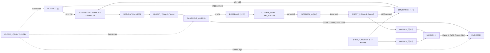

# Guía paso a paso para armar `PIDFRA_trainer` en Scilab Xcos (2024.0.0)

Esta guía está verificada contra las paletas y nombres exactos de bloques de **Scilab 2024.0.0 Xcos**. Permite construir desde la interfaz gráfica el mismo lazo híbrido (planta continua + control discreto a `100 Hz` + cuantización PCNT + zona muerta `MINMOVE`) implementado en [`octave/`](../octave/README.md) y en el firmware del ESP32.

---

## Regla de oro de Xcos antes de empezar

En Xcos existen **dos colores de puertos y cables** que nunca se mezclan:
- **Puertos negros (izquierda / derecha):** señales numéricas (error, duty PWM, ángulo, cuentas).
- **Puertos rojos (arriba / abajo):** **eventos / relojes** de activación discreta. Todo bloque discreto (`DLR`, `DOLLAR_m`, `SAMPHOLD_m`, `Counter`) y todo osciloscopio (`CSCOPE`, `CMSCOPE`) necesita un cable **rojo** desde un bloque `CLOCK_c` conectado a su puerto rojo superior.

---

## Etapa 0 — Abrir Xcos y cargar las variables de contexto

1. Abre **Scilab** y lanza Xcos escribiendo `xcos` en la consola (o haciendo clic en el ícono de Xcos en la barra superior).
2. En la ventana nueva del diagrama, ve al menú:
   **`Simulation → Set Context`**
3. Pega la siguiente línea (ajustando la ruta si corresponde), o pega directamente el contenido completo de [`pidfra_xcos_context.sce`](pidfra_xcos_context.sce):

```scilab
exec('/home/alanvel/Documents/repos/PIDFRA_trainer/scilab/pidfra_xcos_context.sce', -1);
```

4. Pulsa **OK**. Ahora puedes escribir nombres simbólicos (`Ts`, `MINMOVE`, `q0_p`, `tau_m`, `u_static`, `SP_CNT`, etc.) dentro de cualquier bloque y cambiar `MINMOVE = 0` o las ganancias PID desde un único lugar.

---

## Etapa 1 — Bloques necesarios (mapa exacto en el *Palette Browser*)

Si no ves el navegador de paletas, actívalo en **`View → Palette browser`**. Arrastra al lienzo los siguientes bloques:

| # | Rol en el sistema | Paleta en Xcos 2024 | Bloque | Configuración exacta (doble clic) |
|---|---|---|---|---|
| 1 | Reloj de control `100 Hz` | `Sources` (o `Event handling`) | `CLOCK_c` | `Period = Ts` (`0.01`), `Initialisation time = 0` |
| 2 | Consigna escalón (`ANG 90`) | `Sources` | `STEP_FUNCTION` | `Step time = 0.1`, `Initial value = 0`, `Final value = SP_CNT` (`900`) |
| 3 | Comparador `e[k] = r - y` | `Mathematical Operations` | `SUMMATION` | `Sign vector = [1; -1]` |
| 4 | PID Discreto `C(z)` | `Discrete time systems` | `DLR` | `Numerator = q0_p*z^2 + q1_p*z + q2_p`, `Denominator = z^2 - z` |
| 5 | Precomp. `MINMOVE` + Banda `±8` | `Mathematical Operations` | `EXPRESSION` | `Number of inputs = 2`, `Expression = ((u1>0)*(u1+MINMOVE)+(u1<0)*(u1-MINMOVE))*(abs(u2)>TOL_CNT)`, `use zero-crossing = 0` |
| 6 | Saturación PWM 8-bit | `Discontinuities` | `SATURATION` | `Upper limit = PWM_MAX` (`255`), `Lower limit = -PWM_MAX` (`-255`), `zero crossing = 0` |
| 7 | Cuantizador PWM entero | `Discontinuities` | `QUANT_f` | `Step = 1`, `Quantization Type = 2` (*Trunc*) |
| 8 | Retenedor ZOH (`Ts=10ms`) | `Discrete time systems` | `SAMPHOLD_m` | *(Dejar por defecto; conectar reloj rojo `CLOCK_c` arriba)* |
| 9 | Zona muerta motor (`L298N`) | `Discontinuities` | `DEADBAND` | `End of dead band = u_static` (`178`), `Start of dead band = -u_static` (`-178`), `zero crossing = 1` |
| 10 | Dinámica velocidad `Gv(s)` | `Continuous time systems` | `CLR` | `Numerator = Km_counts` (`45`), `Denominator = tau_m*s + 1` |
| 11 | Integrador físico `ω → θ` | `Continuous time systems` | `INTEGRAL_m` | `Initial condition = 0`, `With re-initialization = 0`, `With saturation = 0` |
| 12 | Encoder PCNT (`3600 cpr`) | `Discontinuities` | `QUANT_f` | `Step = 1` (1 cuenta = `0.1°`), `Quantization Type = 1` (*Round*) |
| 13 | Conversión cuentas → grados | `Mathematical Operations` | `GAINBLK_f` | `Gain = CNT2DEG` (`0.1`) — usar 2 copias (una para referencia y otra para salida) |
| 14 | Multiplexor de trazas | `Signal Routing` | `MUX` | `Number of input ports = 2` (para superponer Referencia y Ángulo en el mismo eje) |
| 15 | Osciloscopio doble | `Sinks` | `CMSCOPE` | Ver tabla de configuración abajo |

---

## Etapa 2 — Cableado completo del lazo de Posición (`FSM_POSITION`)



### Configuración exacta de `CMSCOPE` (doble gráfico en una ventana)
Haz doble clic en `CMSCOPE` y configura:
- **Input ports sizes:** `2 1` *(arriba entran 2 señales desde el `MUX`: referencia y ángulo; abajo entra 1 señal: el duty PWM)*
- **Drawing colors:** `1 3 5 7 9 11 13 15`
- **Ymin vector:** `-5 -280`
- **Ymax vector:** `120 280`
- **Refresh period:** `3.5 3.5`
- **Buffer size:** `200`

> **Tip visual:** Puedes seleccionar los bloques de la planta (`DEADBAND`, `CLR`, `INTEGRAL_m`, `QUANT_f`), hacer clic derecho y elegir **`Selection to Superblock`** (`SUPER_f`) para encapsularlos en un solo bloque limpio llamado **"Planta Motor DC + L298N + PCNT"**.

---

## Etapa 3 — Configurar el simulador y correr

1. Ve a **`Simulation → Setup`**:
   - **Final integration time:** `3.5`
   - **Real time scaling:** `0`
   - **Solver kind:** `LSodar` *(por defecto; maneja automáticamente los eventos discretos de `CLOCK_c` y los cruces por cero de `DEADBAND`)*
   - **Max step size:** `0.002` *(garantiza curvas suaves entre muestras de `10 ms`)*
2. Pulsa **Play (▶)** en la barra superior.

### Experimentos inmediatos cambiando una sola variable en `Set Context`
- **Demostrar *Stick-Slip / Hunting*:** cambia `MINMOVE = 0;` → verás que el motor queda trabado lejos de `90°` y el integrador tarda en empujarlo a saltos.
- **Demostrar *Doble Integrador / Sobrepico*:** sube `Ki_p = 2.5;` (con `Kd_p = 0.002;`) → aparecerán oscilaciones fuertes alrededor de `90°`.
- **Demostrar *Ringing* discreto:** sube `Kp_p` progresivamente → observarás la inversión de signo del PWM muestra a muestra.

---

## Etapa 4 — Cómo agregar Anti-Windup (*Clamping*) explícito (opcional)

El bloque compacto `DLR` implementa el PID lineal ideal (sin congelamiento interno del acumulador integral cuando el actuador satura en `±255`). Si quieres reproducir el **anti-windup condicional** exacto de `lib/motor_pid/motor_pid.c`, reemplaza el único bloque `DLR` por las tres ramas paralelas conectadas al mismo `CLOCK_c` (`Ts = 0.01`):

1. **Rama Proporcional (`P`):** `GAINBLK_f` con `Gain = Kp_p`.
2. **Rama Derivativa (`D`):** bloque `DLR` con `Numerator = Kd_p*(z - 1)`, `Denominator = Ts*z` (conectado a `CLOCK_c`).
3. **Rama Integral con *Clamping* (`I`):**
   - Un bloque `DOLLAR_m` (*Discrete time systems*, retardo $z^{-1}$, conectado a `CLOCK_c`) guarda `I[k-1]`.
   - Un bloque `EXPRESSION` de **3 entradas** (`u1 = e[k]`, `u2 = I[k-1]`, `u3 = u_P + u_D`):
     ```scilab
     u2 + Ts*u1 * (((u3 + Ki_p*(u2 + Ts*u1)) < PWM_MAX) + (u1 < 0) > 0) * (((u3 + Ki_p*(u2 + Ts*u1)) > -PWM_MAX) + (u1 > 0) > 0)
     ```
   - La salida de ese `EXPRESSION` es `I[k]`: realiméntala a la entrada de `DOLLAR_m` y multiplícala por `GAINBLK_f (Ki_p)`.
4. Suma `u_P + u_I + u_D` con `SUMMATION ([1; 1; 1])` y conecta a la entrada `u1` del bloque `EXPRESSION` de `MINMOVE`.

---

## Etapa 5 — Adaptar el mismo diagrama a los otros 3 modos

### A. Modo `CLOCK` (aguja segundera: `6°/s = 60 cuentas/s`)
Solo reemplaza el bloque `STEP_FUNCTION` por:
1. Un segundo `CLOCK_c` con `Period = 1.0`, `Initialisation time = 1.0`.
2. Un bloque `Counter` (`Sources → Counter`) con `Minimum = 0`, `Maximum = 60`, `Rule = 1 (Increment)`, activado por ese reloj rojo de `1 s`.
3. Un `GAINBLK_f` con `Gain = CLOCK_STEP_CNT` (`60`).
4. En el bloque `DLR` del PID usa `q0_c`, `q1_c`, `q2_c` y en `Simulation → Setup` pon `Final integration time = 10.5` (y `Refresh period = 10.5 10.5` en `CMSCOPE`).

### B. Modo `SPEED` (control de velocidad + cuantización Método $M$)
1. En `STEP_FUNCTION` pon `Final value = 8.0` (o `35.0`) [RPM].
2. Toma la salida cuantizada del encoder `QUANT_f` (cuentas) y pásala por un bloque `DLR` (activado por `CLOCK_c` de `Ts = 0.01`):
   - `Numerator = RPM_PER_CNT * (z - 1)`
   - `Denominator = z`
   *(Esto calcula exactamente $\hat{\omega}[k] = \frac{60}{N_c T_s}(c[k] - c[k-1])$ con escalones reales de `1.67 RPM`!)*
3. Conecta esa velocidad medida al `-` de `SUMMATION`.
4. En el bloque `DLR` del PID usa `q0_v`, `q1_v`, `q2_v`, pon `SATURATION` en `[0, 255]` (unidireccional), y en `EXPRESSION` usa `max(u1, MINMOVE)*(u1>0)` para el piso del firmware (o `(u1 + MINMOVE)*(u1>0)` para precompensación aditiva).

### C. Filtro EMA de potenciómetros (`lib/pot_adc`)
Inserta entre una fuente ruidosa (`STEP_FUNCTION + RAND_m`) y la entrada de referencia:
- Un `CLOCK_c` de `Period = Tf_pot` (`0.05` s).
- Un bloque `DLR` conectado a ese reloj con:
  - `Numerator = alpha_ema * z` (`0.25*z`)
  - `Denominator = z - (1 - alpha_ema)` (`z - 0.75`).

---

## Solución rápida de errores frecuentes en Xcos

| Mensaje / síntoma en Xcos | Causa habitual | Solución |
|---|---|---|
| `Undefined variable: q0_p` | No se cargó el contexto | Ir a `Simulation → Set Context`, cargar `pidfra_xcos_context.sce` y pulsar **OK** |
| El bloque `DLR` o `CMSCOPE` no hace nada / gráfica vacía | Falta cable rojo de reloj | Conectar la salida **roja** de `CLOCK_c` (`Period = Ts`) al puerto **rojo superior** de `DLR`, `SAMPHOLD_m` y `CMSCOPE` |
| `Algebraic loop detected` | Se conectó salida instantánea directamente a entrada sin retardo/integrador | Verificar que `CLR` (`Km_counts / (tau_m*s + 1)`) o `DOLLAR_m` esté dentro del lazo cerrado |
| La señal se corta a mitad de pantalla | `Refresh period` o `Ymax` del `CMSCOPE` muy chicos | Ajustar `Refresh period` igual a `Final integration time` y ampliar `Ymin/Ymax` |
| El bloque `EXPRESSION` da error de sintaxis | Se usó `sign(u1)` o espacios raros en operadores | Usar `((u1>0)*(u1+MINMOVE)+(u1<0)*(u1-MINMOVE))*(abs(u2)>TOL_CNT)` |
